# Awesome Data App Development Framework 🚀

  

  
  
  
  
  
  

> 🌟 **A curated list of top Data App Development Frameworks, Python Web App Builders, Low-Code Internal Tool Platforms, and Self-Hosted Dashboard Engines.**

**Last updated: November 2026** 📅

---

## 📖 Introduction & SEO Overview

Building data-driven applications no longer requires hand-rolling complex frontend single-page applications with separate REST APIs. Modern **Data App Development Frameworks** empower developers, data scientists, machine learning engineers, and software architects to assemble interactive **dashboards, internal admin panels, AI/LLM interfaces, and analytical tools** with pure Python or intuitive visual drag-and-drop builders.

This directory indexes and tracks both commercial **SaaS platforms** and production-grade **open-source GitHub projects** across:
- 🐍 **Python Data App Frameworks**: Build analytical web applications, reactive widgets, and interactive visualizations with Python.
- 🛠️ **Low-Code & Internal Tool Builders**: Visual app designers connecting directly to PostgreSQL, MySQL, Snowflake, MongoDB, and REST/GraphQL APIs.
- 🤖 **Machine Learning & AI Demo Interfaces**: Rapidly deploy interfaces for computer vision models, LLMs, and agentic workflows.
- 🔒 **Self-Hosted & Privacy-First Frameworks**: On-premise enterprise deployments with full access control, Docker/K8s support, and Git sync.

---

## 📑 Table of Contents

- [📈 Sector Overview & Market Dynamics](#-sector-overview--market-dynamics)
- [☁️ SaaS / Hosted Platforms](#️-saas--hosted-platforms)
- [🔓 Open-Source GitHub Projects](#-open-source-github-projects)
- [💡 Framework Architecture Comparison](#-framework-architecture-comparison)
- [🤝 How to Contribute](#-how-to-contribute)
- [⭐ Star History](#-star-history)
- [💖 Support](#-support)
- [⚠️ Disclaimer](#️-disclaimer)

---

## 📈 Sector Overview & Market Dynamics

The global market for data app platforms and low-code internal tool software is valued at approximately **$31B–$37B in 2025** and projected to climb past **$48B–$66B by 2026** (CAGR ~25–30%). 

The sector is **moderately fragmented**:
- 🏢 **Cloud Data Warehouses & Managed Giants**: Platforms like Snowflake (Streamlit) and Hugging Face (Gradio) anchor cloud compute and ML ecosystem workflows.
- 💼 **Commercial Low-Code Leaders**: Retool and Superblocks hold strong enterprise market share for mission-critical internal admin portals and AI-assisted workflows.
- 🌐 **Vibrant Open-Source Alternatives**: Rather than becoming a winner-take-all market, developer demand for self-hosting, air-gapped security, zero vendor lock-in, and pure-Python reactive programming has sustained high traction for independent open-source projects like Streamlit, ToolJet, Appsmith, Reflex, Budibase, and Dash.

---

## ☁️ SaaS / Hosted Platforms

Below is a breakdown of commercial and hosted platforms, sorted by corporate size (valuation / revenue in descending order):

| Company / Product | Size (Revenue / Valuation) | Pricing | Free Tier Limits | Description & Best For |
| :--- | :--- | :--- | :--- | :--- |
| **[Snowflake Streamlit](https://www.snowflake.com/)** | ~$110B–$120B Market Cap (NYSE: SNOW, ~$3.5B+ ARR) | Pay-as-you-go compute: Standard Edition starts at **$2.00/credit**; Warehouse runtime (XS ~1 credit/hr) or Container runtime (~0.11 credits/hr, ~$160–$175/mo continuous) | **30-day free trial** with **$400 in free compute credits**; Streamlit apps can be hosted and run during the trial period. | Streamlit apps running natively inside Snowflake. Ideal for Snowflake users needing secure data applications without moving data outside the data warehouse. |
| **[Gradio](https://www.gradio.app/)** *(Hugging Face)* | ~$12.93B Acquisition Valuation (~$150M ARR) | Core Python library is free open source; HF Spaces PRO starts at **$9/month**, Team tier at **$20/user/month**, hardware upgrades from **$0.05/hour** (CPU) to **$1.05+/hour** (GPU) | **Forever free tier**: Unlimited public Spaces, community ZeroGPU quota allocation, 2 vCPU / 16GB RAM basic environment. | Rapidly building ML and AI demonstration web interfaces. Best for ML engineers and researchers wanting fast interactive showcases. |
| **[Retool](https://retool.com/)** | ~$3.2B Valuation (~$120M ARR) | Team starts at **$10/builder + $5/user/month** ($8/$4 billed annually); Business tier at **$50/builder + $15/user/month** ($40/$12 billed annually) | **Forever free tier**: Up to **5 users**, unlimited web/mobile apps, 500 workflow runs/month, and 5GB Retool Database storage. | Leading low-code internal tool and UI builder with AI agent capabilities. Best for engineering teams building internal dashboards and CRUD portals. |
| **[Superblocks](https://www.superblocks.com/)** | ~$150M–$185M Valuation (~$5M–$9M ARR, $60M raised) | Teams tier starts at **$125/month flat** (includes up to 15 builders, 1 hosted app, 100 Governed Agent Units); additional apps at **$10/app/month**; Enterprise custom | **14-day free trial** with access to the Teams tier features; no permanent free tier. | Enterprise-grade internal app builder with AI workflow orchestration and agent units. Best for teams needing flat builder pricing. |
| **[Dash by Plotly](https://plotly.com/dash/)** | ~$18M–$50M ARR ($18.4M raised) | Dash Pro starts at **$29/month** (or $290/year billed annually); additional Viewer seats at **$10/seat/month**; Dash Enterprise custom | **Forever free tier**: **1 Dash app**, **1 Creator seat**, **3 private viewers**, and 10 Plotly Studio trial credits; open-source Python Dash library is free. | Mature Python and R data visualization web framework. Best for data science and quantitative analytics teams building complex dashboards. |
| **[Taipy](https://taipy.io/)** | Seed-stage (~$7M raised) | Community Edition is free open source; Business Edition starts at **$360/month billed annually** ($4,320/year for 1 developer + 1 end user) | **Forever free tier**: Community Edition is completely open-source and free for unlimited apps/users (community-supported; business features excluded). | Full-stack Python framework for rapid data science and AI applications. Best for Python developers requiring high-performance scenario management. |
| **[Anvil](https://anvil.works/)** | Bootstrapped / Profitable (~$1M–$3M ARR est.) | Hobby tier starts at **$15/month** ($144/year); Business tier starts at **$99/month**; Production dedicated server from **$1,320/month** | **Forever free tier**: Unlimited apps, 1 developer seat, 50,000 Data Table rows, 100MB storage, 30s task timeout (includes Anvil banner). | Full-stack Python platform enabling frontend and backend development entirely in pure Python. Best for Python developers wanting to avoid JS/HTML/CSS. |

---

## 🔓 Open-Source GitHub Projects

The open-source data app ecosystem is exceptionally diverse. Below are the leading frameworks and self-hosted low-code builders, **sorted in descending order by GitHub Stars ⭐**:

### 1. [Streamlit](https://github.com/streamlit/streamlit)  👑
- **License**: Apache-2.0
- **Tech Stack**: Python, TypeScript, React
- **Overview**: The quintessential open-source Python framework for data science and machine learning apps. Turns Python scripts into shareable interactive web applications in minutes.
- **Key Features**: Instant component updates upon code change, rich native support for charts (Altair, Plotly, Vega-Lite), built-in session state management, caching primitives (`@st.cache_data`, `@st.cache_resource`), and an expansive third-party component ecosystem.
- **Best For**: Data analysts, ML engineers, and researchers wanting rapid prototyping without frontend development.

### 2. [Gradio](https://github.com/gradio-app/gradio)  ⚡
- **License**: Apache-2.0
- **Tech Stack**: Python, Svelte, TypeScript
- **Overview**: The standard framework for building machine learning demos, interactive LLM chat interfaces, and AI utility tools.
- **Key Features**: Wrap any Python function into a web interface with `gr.Interface` or build flexible workflows with `gr.Blocks`; native media support (audio, video, webcam, 3D models); built-in sharing via public tunnel links; tight integration with Hugging Face Spaces.
- **Best For**: AI/ML researchers and engineers demonstrating models, vision pipelines, and generative AI agents.

### 3. [ToolJet](https://github.com/ToolJet/ToolJet)  🛠️
- **License**: AGPL-3.0
- **Tech Stack**: Node.js, TypeScript, React
- **Overview**: Robust open-source low-code platform for creating internal tools, customer support portals, and administrative panels.
- **Key Features**: Visual drag-and-drop canvas with 50+ pre-built widgets; native connectors for PostgreSQL, MySQL, MongoDB, DynamoDB, Snowflake, and REST/GraphQL APIs; ToolJet AI assistant for generating apps and SQL queries; granular role-based permissions (RBAC).
- **Best For**: Engineering teams building complex internal database frontends and operational admin tools.

### 4. [Appsmith](https://github.com/appsmithorg/appsmith)  🧱
- **License**: Apache-2.0
- **Tech Stack**: Java, React, TypeScript, MongoDB
- **Overview**: Mature and widely adopted open-source alternative to Retool for creating business applications and back-office tooling.
- **Key Features**: 45+ customizable UI widgets; embedded JavaScript IDE for custom business logic; Git version control integration for code review and branch deployments; self-hosted with Docker or Kubernetes.
- **Best For**: Enterprises needing strict internal governance, Git workflows, and comprehensive self-hosted database CRUD applications.

### 5. [Reflex](https://github.com/reflex-dev/reflex)  🚀
- **License**: Apache-2.0
- **Tech Stack**: Python, Next.js, React, FastAPI
- **Overview**: Pure Python framework for building full-stack web applications. Python code compiles directly to a high-performance Next.js frontend backed by FastAPI.
- **Key Features**: Write UI, state, and server logic entirely in Python; 60+ customizable components; automatic real-time WebSocket state synchronization; seamlessly extensible with custom React components.
- **Best For**: Python developers wanting complete full-stack web development capabilities without having to learn JavaScript, CSS, or React.

### 6. [Budibase](https://github.com/Budibase/budibase)  💼
- **License**: GPL-3.0 / Commercial
- **Tech Stack**: Node.js, Svelte, CouchDB
- **Overview**: Intuitive, developer-friendly open-source low-code internal tool builder designed for speed and simplicity.
- **Key Features**: Auto-generated CRUD interfaces directly from relational database tables; built-in internal tables; powerful automation and webhook workflow builder; lightweight Svelte client runtime.
- **Best For**: Fast generation of internal CRUD apps, approval workflows, and database record management portals.

### 7. [Dash (plotly/dash)](https://github.com/plotly/dash)  📊
- **License**: MIT
- **Tech Stack**: Python, React, Flask, Plotly.js
- **Overview**: The gold standard analytical application framework for Python, R, and Julia, built on top of Plotly.js data visualization.
- **Key Features**: Declarative reactive architecture; highly configurable interactive charting; enterprise scaling with Dash Enterprise; no JavaScript required to build publication-quality interactive charts.
- **Best For**: Data science, scientific computing, financial modeling, and business intelligence teams requiring pixel-perfect analytical dashboards.

### 8. [Marimo](https://github.com/marimo-team/marimo)  📓
- **License**: Apache-2.0
- **Tech Stack**: Python, WebAssembly (Wasm), TypeScript
- **Overview**: Next-generation reactive notebook and data app framework. Marimo notebooks store code as pure Python scripts and instantly double as interactive web apps.
- **Key Features**: Deterministic DAG-based reactive execution (when a cell or slider changes, only dependent cells run); interactive UI elements (sliders, dropdowns, tables) built in; export to standalone WASM web apps.
- **Best For**: Data teams seeking reproducible interactive notebooks that easily transform into production-ready data applications.

### 9. [Taipy](https://github.com/Avaiga/taipy)  🧬
- **License**: Apache-2.0
- **Tech Stack**: Python, React
- **Overview**: Enterprise-ready Python library combining interactive frontends with computational pipeline orchestration and scenario management.
- **Key Features**: Designed specifically for production data science; native support for running what-if analyses and comparative scenarios; pipeline task graph execution with caching; scalable UI builder.
- **Best For**: Industrial AI, supply chain optimization, and production data science where backend pipeline execution is as important as the frontend.

### 10. [ILLA Cloud](https://github.com/illacloud/illa-builder)  🤖
- **License**: Apache-2.0
- **Tech Stack**: Go, TypeScript, React
- **Overview**: Open-source low-code platform tailored for building internal tools and AI agent workflows.
- **Key Features**: Drag-and-drop builder; native AI Agent integration (connect LLMs directly to app components); extensive database and API connectors; high-performance Go backend.
- **Best For**: Teams wanting to build AI-driven internal dashboards and automation utilities.

### 11. [Evidence](https://github.com/evidence-dev/evidence)  📈
- **License**: MIT
- **Tech Stack**: Svelte, DuckDB, Node.js, Markdown
- **Overview**: Code-driven Business Intelligence and data app tool. Write Markdown and SQL to build fast, interactive data reports and executive dashboards.
- **Key Features**: In-browser analytical queries with DuckDB-WASM; version-controlled in Git; compiles to lightning-fast static websites; eliminates fragile BI UI menus.
- **Best For**: Analytics engineers and SQL developers who want a modern BI reporting stack that fits Git and CI/CD workflows.

### 12. [Panel](https://github.com/holoviz/panel)  🔬
- **License**: BSD-3-Clause
- **Tech Stack**: Python, Bokeh, Tornado
- **Overview**: High-level app and dashboarding solution within the PyData and HoloViz ecosystem.
- **Key Features**: Seamless interoperability with Bokeh, Matplotlib, Plotly, Altair, and PyVista; runs identically in Jupyter notebooks, standalone web servers, or static WebAssembly pages.
- **Best For**: Scientific visualization, academic research, and complex multidimensional data exploration.

### 13. [Lowdefy](https://github.com/lowdefy/lowdefy)  📄
- **License**: Apache-2.0
- **Tech Stack**: Node.js, React, Next.js, YAML
- **Overview**: Config-driven open-source internal tool platform. Build web apps, forms, and admin panels purely by writing YAML or JSON schema files.
- **Key Features**: Everything as code; zero compilation friction; versioned with Git; native support for role-based authentication and database connections.
- **Best For**: Developers who want to configure internal applications declaratively without wrestling with visual drag-and-drop builders.

### 14. [Solara](https://github.com/widgetti/solara)  ☀️
- **License**: MIT
- **Tech Stack**: Python, React, Vue, ipywidgets
- **Overview**: Pure Python web framework with React-like component composition and state management (`use_state`, `use_effect`).
- **Key Features**: Zero boilerplate; components work seamlessly both in Jupyter notebooks and as scalable standalone web applications; built-in routing, layout, and Vuetify/Tailwind styling.
- **Best For**: Python engineers who appreciate React's component mental model and need high-performance, modular UI architecture.

---

## 💡 Framework Architecture Comparison

| Framework / Tool | Primary Language | UI Paradigm | State Management | Target Use Case | Self-Hosted Deployment |
| :--- | :--- | :--- | :--- | :--- | :--- |
| **Streamlit** | Python | Script rerun on event | Built-in Session State | Quick data apps & prototypes | Docker, Kubernetes, Linux VMs |
| **Gradio** | Python | Event-driven blocks | Session State & Cache | ML demos & AI showcases | Docker, HF Spaces |
| **ToolJet** | JS / TS | Visual drag-and-drop | ToolJet reactive context | Operational internal tools & CRUD | Docker, Kubernetes, Helm |
| **Appsmith** | JS / Java | Visual drag-and-drop | JavaScript entity model | Enterprise internal portals & tools | Docker, Kubernetes, Helm |
| **Reflex** | Python | Full-stack reactive | Pure Python Var & State | Full-stack web applications | Docker, FastAPI backend |
| **Budibase** | JS / Svelte | Visual drag-and-drop | Built-in data sync | Fast CRUD tools & automations | Docker, Kubernetes |
| **Dash (Plotly)** | Python / R | Reactive callback graph | Callback Input/Output/State | Complex analytical dashboards | Docker, Dash Enterprise |
| **Marimo** | Python | Reactive cell DAG | Topological DAG state | Reactive notebooks & data apps | Pip, WASM static export |
| **Taipy** | Python | Declarative GUI & DAG | Scenarios & Data Pipelines | Enterprise AI & What-if analytics | Docker, Taipy Cloud |
| **Evidence** | SQL / Markdown | Code-driven BI | DuckDB-Wasm reactive cache | Fast BI reports & analytical docs | Static site (Vercel, Netlify, S3) |

---

## 🤝 How to Contribute

We welcome additions, fixes, and updates from the open-source community! 💖

1. 🍴 **Fork the repository**.
2. 🌿 **Create a descriptive feature branch**: `git checkout -b add-my-framework`.
3. 📝 **Add/update the framework**: Follow the established format including live GitHub star count badge (`style=social&color=white`), license, tech stack, and primary use cases.
4. 🚀 **Submit a Pull Request** with a clear explanation of why the tool is beneficial to data app developers.

---

## ⭐ Star History

---

## 💖 Support

If you find this repository helpful, consider supporting the maintenance and continuous updates of this project:

- ⭐ **Star this repository** to help others discover it!
- 🍴 **Fork and share** with colleagues and developer communities.
- ☕ **Buy me a coffee / Sponsor on GitHub**: [Sponsor ishandutta2007](https://github.com/sponsors/ishandutta2007)

Thank you so much to all the sponsors, contributors, and the global open-source community! 🙏

---

## ⚠️ Disclaimer

- This list is **community-curated** for informational and educational purposes—inclusion does not represent a commercial endorsement.
- Verify enterprise security, compliance (GDPR, CCPA, SOC2, HIPAA), and authentication protocols before connecting internal production databases to any third-party framework or self-hosted deployment.
- Pricing, tiers, and features are subject to change by respective vendors and maintainers; please refer to the official platform links for the latest terms.

---

  <b>Built with ❤️ for data developers, engineers, and researchers worldwide.</b>

